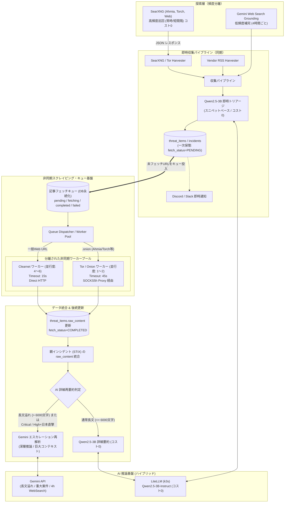
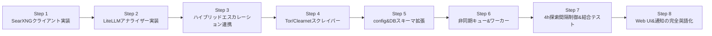

# SearXNG連携 & 非同期記事スクレイピング基盤（Tor/.onion対応）および ハイブリッドAI分析（Qwen2.5-3B on k3s × Gemini）実装計画

## 1. 概要と目的

### 現状の背景と課題
- **探索エンジン（SearXNG）の主軸化**:
  社内/ラボ環境の **SearXNG インスタンス**（`https://searxng.lab.internal/search?q=...&format=json`）を横断探索プロバイダーとして高頻度巡回に利用します。SearXNG はバックエンドで **Ahmia や Torch 等のダークウェブ検索エンジン**および Web 検索エンジンを統合し、構造化された JSON で結果を返却します。
- **課題1: 出力リンク先への未アクセス**:
  現状は検索結果に含まれるスニペット（抜粋・概要）のみをインシデント化しており、出力された個別の `.onion` サイトや Web 記事への本文アクセス（ディープフェッチ）は行われていません。
- **課題2: Tor通信および外部検索のレイテンシ**:
  SearXNG 自体のメタサーチ処理、および個別の `.onion` ドメインへのアクセスはどちらも Tor 回線や外部依存のため、15秒〜45秒以上のレイテンシや一時的なタイムアウト（Gateway Timeout 等）が発生し得ます。これをパイプライン同期処理で行うと全体がスタックします。
- **課題3: AI 利用コストと精度の両立（ハイブリッドAI設計）**:
  全件を外部商用 AI API（Gemini等）で解析するとコストが嵩みます。そこで、ラボ内 k3s 上で提供される **LiteLLM 経由の Qwen2.5-3B-Instruct**（`https://litellm.lab.internal/v1/chat/completions`）をメイン（一次トリアージ・通常要約・クエリ生成）としてコストゼロでフル稼働させます。
  一方、**Gemini は「長文コンテキスト溢れ」「最重要インシデントの深層精査」「4hごとの緩やかなWeb Search補完」という要所のみに限定投入**し、コスト90%以上削減と最高精度の両立を図ります。

### 目的
1. **SearXNG JSON API クライアントの実装**:
   - `https://searxng.lab.internal/search?q=...&format=json` を叩き、Ahmia / Torch 等から集約された検索結果（タイトル、スニペット、URL、エンジン情報）を安定して取得・パース。
   - 内部 TLS 自己署名証明書の許容、タイムアウト耐性（緩和設定）とエラーハンドリングを強化。
2. **二段階アーキテクチャの確立**:
   - **第1段階（即時速報）**: SearXNG のスニペットや RSS 抜粋で即座にインシデント登録・ローカル AI（Qwen2.5-3B）による一次判定・アラート通知を行う（速報性を100%維持）。
   - **第2段階（非同期本文フェッチ）**: 検索結果から得られた `.onion` ドメインや Web 記事 URL を専用キューに積み、バックグラウンドの常駐ワーカーが Tor / Clearnet 経由で非同期に全文をスクレイピング・保管。
3. **Tor / Clearnet 分離ワーカーの実装**:
   - `.onion` URL は Tor SOCKS5h プロキシ経由の Tor 専用ワーカーで取得。
   - 一般の Web URL は Clearnet 専用ワーカーで取得。
4. **ハイブリッド AI アーキテクチャの確立（Qwen2.5-3B × Gemini）**:
   - **メイン（日常・大量処理: コスト0）**: LiteLLM（Qwen2.5-3B-Instruct）で一次トリアージ、短〜中長文要約、クエリ生成。
   - **エスカレーション（要所のみ）**: Gemini を「長文コンテキスト溢れ時（フォールバック）」および「Critical/High×日本直撃の重要案件」に限定投入。
   - **探索の頻度分離**: 検索の主軸は SearXNG（高頻度・常時）とし、Gemini の Google Web Search は 4 時間に 1 回程度の低頻度補完とする。
5. **`config.yaml` による完全なパラメータ制御**:
   - SearXNG のエンドポイント、スクレイパーの並行数/タイムアウト/リトライ、AI エスカレーション条件等をすべて YAML で一元管理。
6. **UI & レポートの英語統一（English-First）**:
   - Web UI、アラート通知（Discord/Slack）、AI 分析結果（タイトル、要約、影響分析、推奨アクション）をすべて英語で統一。
   - ブラウザの Google 翻訳等で簡単に多言語対応できるようにしつつ、Qwen2.5-3B の英語プロンプトによる推論精度・語彙力向上と多言語混入（中国語リーク）リスクを徹底排除。

---

## 2. システムアーキテクチャ設計



---

## 3. 詳細仕様と設定設計

### 3.1. `config.yaml` 設定仕様（完全制御）

`config.yaml` に以下の設定セクションを追加・拡張します：

```yaml
# -------------------------------------------------------------
# AI 分析基盤設定 (ハイブリッド: Qwen2.5-3B on k3s × Gemini)
# -------------------------------------------------------------
ai:
  # メインエンジン (LiteLLM / k3s: コスト0)
  primary_provider: "openai_compatible"
  endpoint: "https://litellm.lab.internal/v1/chat/completions"
  model: "qwen2.5-3b-instruct"
  temperature: 0.1
  insecure_skip_verify: true           # 社内自己署名証明書 (-k) 許容
  timeout_seconds: 60

  # エスカレーションエンジン (Gemini: 要所のみ投入)
  escalation:
    enabled: true                      # 要所での Gemini 活用を有効化
    gemini_api_key: "${GEMINI_API_KEY}"
    gemini_model: "gemini-3.5-flash-lite"
    
    # トリガー条件1: コンテキスト溢れ時の長文フォールバック
    max_local_content_runes: 6000      # 6,000文字を超える巨大記事は Gemini で要約
    
    # トリガー条件2: 重大インシデントの深層精査
    trigger_severities: ["Critical"]
    trigger_japan_direct: true         # High かつ 日本直撃（Direct）なら Gemini 精査

# -------------------------------------------------------------
# 横断探索設定 (SearXNG 主軸 / Gemini Web Search 補完)
# -------------------------------------------------------------
sources:
  # 【主軸】SearXNG (常時・短間隔で実行)
  darkweb_onion:
    - name: "SearXNG横断探索: 日本関連組織ランサムウェア・データ侵害"
      url: "https://searxng.lab.internal/search"
      type: "searxng"
      engines: "ahmia,torch"
      categories: "onions"
      directive: "日本国内の企業や組織を標的としたランサムウェアリークサイト（DLS）の暴露情報やデータ侵害"
      query: "japan ransomware leak breach"
      timeout_seconds: 30
      enabled: true

    - name: "SearXNG横断探索: 未修正ゼロデイ・悪用PoC・初期アクセス販売"
      url: "https://searxng.lab.internal/search"
      type: "searxng"
      engines: "ahmia,torch"
      directive: "ゼロデイ脆弱性の悪用PoC、エクスプロイトコード、VPNや境界機器の初期アクセス販売"
      query: "0day exploit poc vulnerability broker"
      timeout_seconds: 30
      enabled: true

  # 【低頻度補完】Gemini Web Search Grounding (4時間ごとに実行)
  web_search:
    - name: "Google Grounding定期補完探索"
      directive: "日本国内組織を標的とする最新のサイバー攻撃・重大インシデント動向"
      interval_minutes: 240          # 4時間 (240分) ごとに実行
      enabled: true

# -------------------------------------------------------------
# 非同期記事スクレイパー設定 (Async Article Content Scraper)
# -------------------------------------------------------------
scraper:
  enabled: true                      # 非同期スクレイピング全体の有効/無効
  clearnet_enabled: true             # 一般Webサイト（RSS、ニュース等）のスクレイピング有効/無効
  tor_enabled: true                  # .onion ドメインのスクレイピング有効/無効

  # ワーカー並行度設定
  clearnet_concurrency: 5            # 一般Web向けワーカー並行数 (デフォルト: 5)
  tor_concurrency: 2                 # Tor/.onion 向けワーカー並行数 (デフォルト: 2)

  # タイムアウト設定（秒）
  clearnet_timeout_seconds: 15       # 一般Web向けHTTPタイムアウト
  tor_timeout_seconds: 45            # Tor/.onion 向けHTTPタイムアウト

  # キュー・リトライ制御
  worker_interval_seconds: 10        # キュー監視ポーリング間隔 (秒)
  batch_size: 20                     # 1回のポーリングで取得する最大件数
  max_attempts: 2                    # 失敗時の最大試行回数 (404/タイムアウト等)

  # AI再解析・後続連携
  auto_re_analyze: true              # 本文取得完了時に自動再要約を実行 (Qwen2.5/Geminiハイブリッド)
```

### 3.2. 役割分担マトリクス

| 処理項目 | 実行頻度 | 担当エンジン | コスト・特徴 |
| :--- | :--- | :---: | :--- |
| **SearXNG 横断探索** | 毎回収集（常時/15〜30分） | **SearXNG API** | **コスト0**。Ahmia/Torch/Clearnet のメタサーチ |
| **スニペット即時判定** | 毎回収集（1日数千件） | **Qwen2.5-3B (LiteLLM)** | **コスト0**。高速トリアージ・分類・CVE抽出 |
| **通常本文の再要約** | キュー取得時（本文 <= 6000文字） | **Qwen2.5-3B (LiteLLM)** | **コスト0**。標準的な記事要約 |
| **長文本文の再要約** | キュー取得時（本文 > 6000文字） | **Gemini API** | コンテキスト溢れ防止。巨大レポートを精確に読解 |
| **重大インシデント深層精査**| 発生時（Critical または High×日本直撃） | **Gemini API** | 最高品質の影響分析・サプライチェーン評価 |
| **Web Search 探索補完** | **4時間ごと (240分)** | **Gemini Web Search** | 低頻度で Google リアルタイム検索の網羅性を補完 |

---

## 4. 実装ステップ



### Step 1: SearXNG JSON API クライアントの実装
- [`darkweb.go`](file:///home/dapt/projects/information_harvester/backend/internal/harvesters/darkweb.go) に SearXNG API（`format=json`）呼び出し処理を実装。
- `https://searxng.lab.internal/search` への TLS 自己署名/内部証明書対応、タイムアウト緩和設定、クエリ・パラメータ付与。
- Ahmia / Torch 等のエンジン情報やスニペット、`.onion` URL を抽出するパース処理を実装。

### Step 2: LiteLLM / OpenAI 互換 AI アナライザーの実装
- `backend/internal/analyzer` に OpenAI 互換クライアントを実装。
- `https://litellm.lab.internal/v1/chat/completions` へ `qwen2.5-3b-instruct` でリクエストを送信。
- 英語プロンプト・英語 JSON 出力（TitleEn, SummaryEn, ImpactAnalysisEn, RecommendedActionsEn）に対応。
- 自己署名証明書（`InsecureSkipVerify: true`）対応。
- 単一アイテム分析（`Analyze`）、バッチ分析（`AnalyzeBatch`）、検索クエリ生成（`GenerateSearchQueries`）に対応。

### Step 3: ハイブリッド・エスカレーション制御の実装
- 本文文字数判定（`> max_local_content_runes`）による Gemini への自動フォールバック。
- `severity == "Critical"` または `severity == "High" && japan_relevance == "Direct"` 判定時の Gemini 深層分析エスカレーションロジックを実装。

### Step 4: Tor / Clearnet 記事スクレイパーの実装
- [`article.go`](file:///home/dapt/projects/information_harvester/backend/internal/harvesters/article.go) に `FetchOnionArticleContent`（Tor プロキシ経由）を追加。
- 既存の Clearnet 用 `FetchArticleContent` と共通の HTML 本文抽出ロジック（`ExtractArticleTextFromHTML`）を適用。

### Step 5: `config.yaml` & `config.go` 設定構造体の拡張 & DB スキーマ拡張
- `config.go` に `ScraperConfig` および `ai.escalation`, `web_search.interval_minutes` を追加。
- PostgreSQL / SQLite の `threat_items` に `fetch_status`, `fetch_attempts`, `fetch_error`, `fetched_at` を追加。

### Step 6: 非同期キューマネージャー & ワーカーエンジンの実装
- バックグラウンドで常駐するキューディスパッチャーを実装。
- `pending` なアイテムを定期取得し、Clearnet / Tor 各ワーカープールへ振り分けて本文フェッチを実行。
- 取得成功時に `raw_content` を上書き更新し、ハイブリッド再要約を実行して親インシデントへ同期。

### Step 7: Web Search 4h 実行間隔制御 & パイプライン結合テスト
- `websearch.go` の巡回実行間隔を `interval_minutes`（4時間 = 240分）に基づきスキップ判定するロジックを実装。
- 全体の結合テストで「SearXNG 高頻度取得 → Qwen2.5 一次判定 → 非同期フェッチ → ハイブリッド再要約」および「4hごとの Gemini Web Search 補完」の連携を検証。

### Step 8: Web UI & 通知の完全英語化（English-First）
- `web/app/page.tsx`: 日本語のラベル、トースト通知、プレースホルダー、モーダル等の UI テキストを英語に統一。
- `backend/internal/notifiers`: Discord / Slack / Webhook 通知メッセージを英語フォーマットに刷新。
- `backend/internal/models`: インシデントのサマリー・影響分析表示を英語対応。
