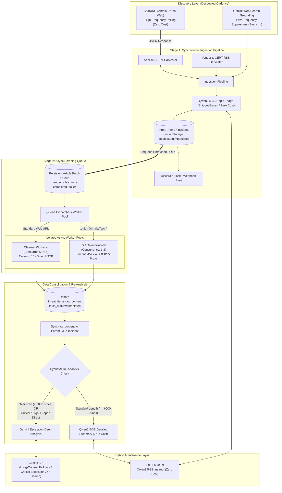

# Architecture Plan: SearXNG Integration, Async Article Scraping (Tor/.onion & Clearnet), and Hybrid AI Analysis (Qwen2.5-3B × Gemini)

## 1. Overview & Objectives

### Background & Challenges
- **Primary Discovery Engine (SearXNG)**:
  An internal/self-hosted **SearXNG instance** (`https://searxng.lab.internal/search?q=...&format=json`) serves as the high-frequency cross-search provider. SearXNG aggregates **dark web search engines (Ahmia, Torch)** and clearnet web search engines into structured JSON responses.
- **Challenge 1: Deep Fetching of Linked Articles**:
  Previously, only search result snippets were ingested as incidents without fetching the full body text of individual `.onion` sites or clearnet articles.
- **Challenge 2: Tor & External Search Latency**:
  SearXNG metasearch queries and direct `.onion` domain requests over Tor can incur 15–45+ second latencies or temporary gateway timeouts. Performing these synchronously blocks the ingestion pipeline.
- **Challenge 3: Balancing AI Cost & Accuracy (Hybrid AI Architecture)**:
  Analyzing every item via commercial external LLM APIs incurs significant cost. By using a self-hosted **LiteLLM Qwen2.5-3B-Instruct** endpoint (`https://litellm.lab.internal/v1/chat/completions`) as the primary engine (initial triage, standard summarization, and query generation) at zero marginal cost, and **escalating to Gemini only for oversized contexts, Critical/High Japan-direct incidents, and 4-hour periodic web search grounding**, the platform reduces API costs by over 90% while maintaining high analytical accuracy.

### Objectives
1. **SearXNG JSON API Client**:
   - Query `https://searxng.lab.internal/search?q=...&format=json` to reliably parse aggregated search results (title, snippet, URL, engine metadata) from Ahmia, Torch, and clearnet engines.
   - Support internal self-signed TLS certificates, configurable timeouts, and resilient error handling.
2. **Two-Stage Ingestion & Enrichment Architecture**:
   - **Stage 1 (Immediate Triage)**: Register incidents immediately from SearXNG snippets or RSS summaries, run primary triage via local AI (Qwen2.5-3B), and dispatch immediate alerts.
   - **Stage 2 (Async Full-Text Scraping)**: Enqueue discovered `.onion` and clearnet article URLs into a persistent database queue processed asynchronously by background workers.
3. **Isolated Tor & Clearnet Worker Pools**:
   - Route `.onion` URLs through dedicated Tor workers via a SOCKS5h proxy.
   - Route standard web URLs through dedicated Clearnet workers.
4. **Hybrid AI Architecture (Qwen2.5-3B × Gemini)**:
   - **Primary (High-Volume / Zero Cost)**: LiteLLM (`Qwen2.5-3B-Instruct`) handles initial triage, short-to-medium article summarization, and search query generation.
   - **Escalation (Targeted High-Impact)**: Escalate to Gemini when article length exceeds local context thresholds or when an incident is classified as `Critical` or `High` with `Direct` Japan relevance.
   - **Decoupled Discovery Cadence**: Run SearXNG continuously at short intervals, while throttling Gemini Google Web Search Grounding to once every 4 hours.
5. **Declarative Configuration via `config.yaml`**:
   - Manage SearXNG endpoints, scraper concurrency/timeouts/retries, and AI escalation rules centrally in `config.yaml`.
6. **Bilingual & English-First Intelligence Standardization**:
   - Standardize structured AI outputs and notifications while supporting `/en` and `/ja` views in the Next.js Cyber SOC Web Dashboard.

---

## 2. System Architecture



---

## 3. Configuration Specification (`config.yaml`)

```yaml
# -------------------------------------------------------------
# AI Analysis Engine (Hybrid: Qwen2.5-3B on k3s × Gemini)
# -------------------------------------------------------------
ai:
  # Primary Engine (LiteLLM / k3s: Zero Cost)
  primary_provider: "openai_compatible"
  endpoint: "https://litellm.lab.internal/v1/chat/completions"
  model: "qwen2.5-3b-instruct"
  temperature: 0.1
  insecure_skip_verify: true
  timeout_seconds: 60

  # Escalation Engine (Gemini: Targeted High-Impact / Long Context)
  escalation:
    enabled: true
    gemini_api_key: "${GEMINI_API_KEY}"
    gemini_model: "gemini-3.5-flash-lite"
    
    # Trigger 1: Long-context fallback when article exceeds rune threshold
    max_local_content_runes: 6000
    
    # Trigger 2: High-severity & Japan-direct deep inspection
    trigger_severities: ["Critical"]
    trigger_japan_direct: true

# -------------------------------------------------------------
# Discovery Sources (SearXNG Primary / Gemini Grounding Supplement)
# -------------------------------------------------------------
sources:
  darkweb_onion:
    - name: "SearXNG Cross-Search: Japan Ransomware & Data Breaches"
      url: "https://searxng.lab.internal/search"
      type: "searxng"
      engines: "ahmia,torch"
      categories: "onions"
      directive: "Ransomware data leak sites (DLS) and data breaches targeting Japanese organizations"
      query: "japan ransomware leak breach"
      timeout_seconds: 30
      enabled: true

    - name: "SearXNG Cross-Search: Zero-Day Exploits & Initial Access Brokers"
      url: "https://searxng.lab.internal/search"
      type: "searxng"
      engines: "ahmia,torch"
      directive: "Zero-day exploit PoCs, vulnerability brokers, and VPN/edge initial access listings"
      query: "0day exploit poc vulnerability broker"
      timeout_seconds: 30
      enabled: true

  web_search:
    - name: "Google Grounding Periodic Supplement"
      directive: "Latest cyber attacks and high-impact security incidents targeting Japanese organizations"
      interval_minutes: 240
      enabled: true

# -------------------------------------------------------------
# Async Article Content Scraper
# -------------------------------------------------------------
scraper:
  enabled: true
  clearnet_enabled: true
  tor_enabled: true

  clearnet_concurrency: 5
  tor_concurrency: 2

  clearnet_timeout_seconds: 15
  tor_timeout_seconds: 45

  worker_interval_seconds: 10
  batch_size: 20
  max_attempts: 2

  auto_re_analyze: true
```

### Responsibility Matrix

| Processing Stage | Execution Cadence | Responsible Engine | Cost & Characteristics |
| :--- | :--- | :---: | :--- |
| **SearXNG Cross-Search** | Every collection cycle (15–30m) | **SearXNG API** | **Zero cost**. Metasearch across Ahmia, Torch, and Clearnet |
| **Snippet Rapid Triage** | Every collection cycle | **Qwen2.5-3B (LiteLLM)** | **Zero cost**. Fast triage, classification, and CVE extraction |
| **Standard Full-Text Summary** | On queue fetch (`<= 6000` runes) | **Qwen2.5-3B (LiteLLM)** | **Zero cost**. Detailed article summarization |
| **Long-Context Summary** | On queue fetch (`> 6000` runes) | **Gemini API** | Prevents context overflow on long technical reports |
| **Critical Incident Deep Audit** | On `Critical` or `High` + Japan Direct | **Gemini API** | High-precision impact analysis & supply-chain assessment |
| **Web Search Grounding** | **Every 4 hours (240m)** | **Gemini Web Search** | Low-frequency real-time Google Search coverage |

---

## 4. Implementation Milestones

1. **Step 1: SearXNG JSON API Client (`backend/internal/harvesters/darkweb.go`)**
   - Query SearXNG (`format=json`), support internal TLS (`InsecureSkipVerify`), and extract Ahmia/Torch `.onion` results.
2. **Step 2: LiteLLM / OpenAI-Compatible Analyzer (`backend/internal/analyzer`)**
   - Support single-item analysis, batch analysis (`AnalyzeBatch`), and search query generation via `qwen2.5-3b-instruct`.
3. **Step 3: Hybrid Escalation Controller**
   - Automatically escalate to Gemini when rune length exceeds `max_local_content_runes` or when severity/relevance matches escalation triggers.
4. **Step 4: Tor & Clearnet Article Scrapers (`backend/internal/harvesters/article.go`)**
   - Implement `FetchOnionArticleContent` via Tor SOCKS5h proxy and `FetchArticleContent` for clearnet URLs with shared HTML text extraction.
5. **Step 5: Config & Database Schema Expansion**
   - Add `ScraperConfig`, `ai.escalation`, and `fetch_status` / `fetch_attempts` / `fetch_error` / `fetched_at` tracking columns.
6. **Step 6: Async Queue Manager & Worker Pool (`backend/internal/scraper`)**
   - Poll `pending` items, dispatch to isolated Clearnet/Tor worker pools, update `raw_content`, and trigger hybrid re-analysis.
7. **Step 7: 4-Hour Web Search Throttling & Integration Testing**
   - Enforce `interval_minutes` throttling for Gemini Grounded Search and verify end-to-end pipeline execution.
8. **Step 8: Cyber SOC Dashboard & Bilingual Support (`web/`)**
   - Provide `/en` and `/ja` dashboard views, RSS feeds (`/rss`), and protected admin operations.
